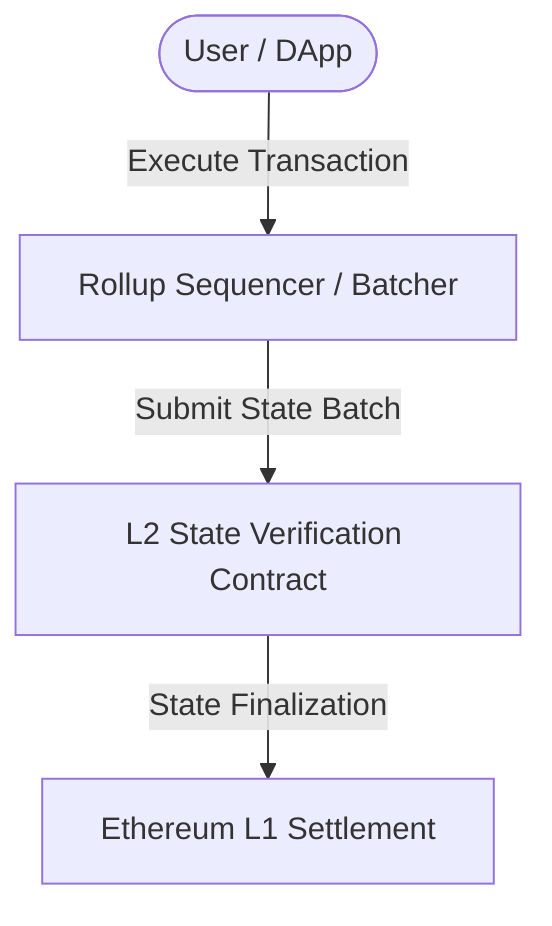

# flare-fassets-cross-chain-agent

[](https://soliditylang.org/)
[](https://getfoundry.sh/)
[](https://opensource.org/licenses/MIT)

State connector attestation verifier and non-smart contract asset minting agent on Flare.

## Architecture



## Features
- **Gas Efficiency**: Optimized inline assembly and EVM via-IR compilation.
- **Security**: Built-in re-entrancy protection and cryptographic signature checks.
- **Compatibility**: Adheres to ERC-4337 and modular rollup standards.

## Testing & Compilation
```bash
forge build
forge test -vvv
```

## License
MIT
